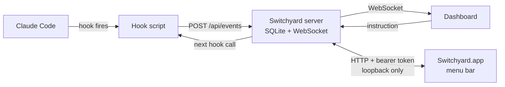

# Switchyard

Switchyard watches your AI coding agents from one local dashboard, and its Mac app sorts your browser, terminal and editor windows by project.

<!-- TODO: the screenshots and GIF below were taken before the rename and still show the old name.
     New ones are needed, including the Contexts tab and the Mac app's menu bar and switcher. -->


## What it does

**Agents.** Hooks installed into Claude Code report every tool call to a local server. The dashboard shows:

- Live status for each agent: active, idle or disconnected, plus the tool and file it is on right now.
- A timeline of tool calls you can expand to see the full input and output.
- Alerts for agents that are stuck, looping, correcting the same file over and over, or hitting errors.
- Token costs read from Claude Code's session logs, by day, model and session.
- A box for sending an instruction to an agent. It is delivered on the agent's next tool call.

**Contexts.** A context is a project folder or a named topic. The Mac app and the server work together to:

- Sort your Chrome, Arc, Ghostty and editor windows into the project they belong to.
- Give each project its own virtual desktop. Switching to a project shows its windows and hides the rest.
- Switch with <kbd>⌥</kbd><kbd>Space</kbd> (a search box) or <kbd>⌥</kbd><kbd>1</kbd> to <kbd>⌥</kbd><kbd>9</kbd>.
- Park a project: its browser windows are closed and their tabs saved. Restore reopens them where they were.
- Name Chrome windows after their project.
- Send one notification when an agent starts waiting on you.

**Dashboard.** The Contexts tab lists every project with its agents, windows, cost today and park or switch buttons. Windows it couldn't place are shown as Unsorted so you can assign them by hand. See [docs/dashboard.md](docs/dashboard.md) for the panels, alerts and keyboard shortcuts.

<div align="center">
<table>
<tr>
<td align="center"><br><sub>Agents</sub></td>
<td align="center"><br><sub>Timeline</sub></td>
<td align="center"><br><sub>Missions</sub></td>
<td align="center"><br><sub>Usage</sub></td>
</tr>
</table>
</div>

## Requirements

- Node.js 22.18 or newer. The server has no runtime dependencies: it uses Node's built-in SQLite, HTTP and TypeScript support.
- [Claude Code](https://docs.claude.com/en/docs/claude-code). Cursor CLI sessions are shown as running or stopped only.
- macOS 14 or newer for the window features. The dashboard and agent monitoring work on any OS Node supports.
- To build the Mac app: Swift 5.9+ (Xcode or the Command Line Tools).

## Install and quick start

Switchyard runs from a clone of this repository.

1. Get the code. `npm install` is only needed for development (it installs the TypeScript compiler for type checks).

   ```bash
   git clone https://github.com/cyruspastelero/claude-mission-control.git
   cd claude-mission-control
   ```

2. Add the hooks to Claude Code. This edits `~/.claude/settings.json` (a backup is saved next to it) and is safe to run again.

   ```bash
   node src/index.ts install
   ```

3. Start the server.

   ```bash
   node src/index.ts
   ```

   Open <http://localhost:4280> and enter the 6-digit access code printed in the terminal. Then use Claude Code as usual. Agents appear on their own.

   On a Mac, keep it running in the background instead (starts at login, restarts if it stops, local only):

   ```bash
   node src/index.ts install-service     # remove with uninstall-service
   ```

   The access code changes on every start. Get the current one from the Switchyard menu bar icon ("Copy dashboard access code") or from `~/.switchyard/server.log`.

4. Optional, for window control: build and open the Mac app.

   ```bash
   bash macos/build-app.sh
   open macos/build/Switchyard.app
   ```

   Grant **Accessibility** when macOS asks (System Settings > Privacy & Security > Accessibility). Grant **Automation** for Chrome and Arc the first time the app talks to them. Without Accessibility the app can't move windows; its menu says so until you grant it.

To stop reporting, run `node src/index.ts uninstall`.

## How it works



1. Claude Code runs `src/hook/switchyard-hook.js` on tool use, subagent start and stop, notifications and session end. The script posts the event to the server and, before a tool call, fetches any instruction you queued and prints it to stderr, where the agent sees it.
2. The server stores events in SQLite, works out agent status and alerts, and pushes updates to the dashboard over a WebSocket.
3. The Mac app reports which windows exist (and the tabs in Chrome and Arc). The server decides which project each belongs to and sends back commands: show these windows, hide the others, name this window, open this tab. The app carries them out. The server never calls macOS APIs itself.
4. Hiding a window means moving it off-screen with the Accessibility API and moving it back on switch. macOS has no public API for moving windows between its own Spaces.

Everything runs on your machine. Nothing is sent to a remote service.

## Configuration

Each variable can also be set with its old `MC_` name. `SWITCHYARD_` wins if both are set.

| Variable | Default | What it does |
|---|---|---|
| `SWITCHYARD_DATA_DIR` | `~/.switchyard` | Where the database and hook token live. |
| `SWITCHYARD_EVENT_RETENTION_DAYS` | `7` | Days to keep events. Daily totals are kept longer. |
| `SWITCHYARD_COST_PER_TOOL_CALL` | `0.003` | Cost estimate per tool call when session logs aren't available. |
| `SWITCHYARD_HOST`, `SWITCHYARD_PORT` | `localhost`, `4280` | Where the hook script sends events. Old names: `CLAUDE_MC_HOST`, `CLAUDE_MC_PORT`. |
| `SWITCHYARD_URL` | `http://127.0.0.1:4280` | Server address the Mac app uses. Must be a loopback address; anything else is ignored. Old name: `MC_URL`. |

Command line: `--port <n>` changes the port, `--open` opens the browser. The server listens on this machine only. `--lan` also opens it to your local network, over plain HTTP; use it only on a network you trust.

## Privacy and security

- **This machine only.** The server listens on `127.0.0.1` and answers only for `localhost` names, so other devices, other websites and rebound DNS names can't reach it. It makes no outbound connections, and the dashboard loads nothing from other hosts. `--lan` is an explicit opt-in.
- **What is stored.** `~/.switchyard/data.db` (mode `0600`, in a `0700` folder) holds agents, a short summary of each tool call, instructions you sent, contexts, window names, and the URLs of parked tabs. For a tool call it keeps the file path or command (truncated) and a 200-character preview of the output, with anything that looks like a key, token or password replaced by `[REDACTED]`. File contents and edit text are never stored. Events are deleted after 7 days by default. Costs are computed by reading `~/.claude/projects/*.jsonl`, which Switchyard never writes to.
- **Access code.** A random 6-digit code is generated each time the server starts and shown in the terminal, the server log and the Mac app's menu. Sessions last 24 hours and use an `HttpOnly`, `SameSite=Strict` cookie. After 5 wrong codes from one address in 15 minutes, that address is locked out.
- **Hook token.** The hook script and the Mac app authenticate with a bearer token in `~/.switchyard/hook-token`, written with mode `0600`. The app's endpoints accept it from loopback only, and never from a browser.
- **Request limits.** Bodies are capped at 1 MB, WebSocket connections at 50, and every request body is validated before use.
- **Secret scanning.** Tool input and output are checked for things that look like keys and tokens before they are stored. They are redacted, and the dashboard warns you when one appears.
- See [SECURITY.md](SECURITY.md) for the checks that were run and how to report a problem.

## Limitations

- Window control exists only on macOS 14+. There is no Windows or Linux equivalent.
- Chrome can't move a tab between windows through AppleScript. Switchyard opens the tab's URL in the target window and closes the original, so in-page state is lost. It only does this when you click.
- Arc windows can't be named.
- Ghostty has no scripting interface. Switchyard matches its windows by the Claude session title or the project folder in the window title, so a terminal Claude hasn't titled may stay Unsorted.
- Hiding a window parks it at the bottom-right corner of the screen. With a monitor to the right, a sliver can show there.
- Instructions reach an agent on its next tool call, not immediately.
- Cursor CLI sessions show running or stopped only.

## Development

```bash
npm test                 # node:test (server, hooks, contexts, security)
npm run typecheck        # type check
npm run dev              # run the server from source
npm run build            # compile to dist/
```

The Mac app is a Swift package in `macos/`. `bash macos/build-app.sh` builds it and wraps it into `macos/build/Switchyard.app`, signed ad hoc. If you only have the Command Line Tools, `swift build` fails because `xcrun --show-sdk-platform-path` doesn't work there. The script notices and compiles the same sources with `swiftc` instead. Because the signature is ad hoc, macOS may ask for the Accessibility grant again after each rebuild.

API routes are listed in [docs/API.md](docs/API.md).

## Migrating from Claude Mission Control

Switchyard is the new name of Claude Mission Control. Nothing is lost on upgrade.

1. Data: on first start, if `~/.switchyard` doesn't exist and `~/.claude-mission-control` does, the server moves it and prints one line. Your history and settings come with it.
2. Hooks: run `node src/index.ts install` again. It replaces the old entries in `~/.claude/settings.json`, including ones that point at `mission-control-hook.js`, so you won't end up with two. `uninstall` removes both kinds.
3. Environment variables: `MC_DATA_DIR`, `MC_EVENT_RETENTION_DAYS`, `MC_COST_PER_TOOL_CALL`, `MC_URL`, `CLAUDE_MC_HOST` and `CLAUDE_MC_PORT` still work.
4. Dashboard: you'll sign in once more with a fresh access code (that happens on every restart anyway). Saved panel states carry over.

The GitHub repository still has its old name for now.

## Credits

Ideas came from [sniffly](https://github.com/chiphuyen/sniffly) (cost from JSONL logs), [claude-hud](https://github.com/jarrodwatts/claude-hud) (context window health), [builderz-labs/mission-control](https://github.com/builderz-labs/mission-control) (secret scanning), [disler/observability](https://github.com/disler/claude-code-hooks-multi-agent-observability) (expandable timeline), [claude-squad](https://github.com/smtg-ai/claude-squad) (per-agent diff stats), [agenttop](https://github.com/vicarious11/agenttop) (anti-pattern detection), and [claude-devfleet](https://github.com/LEC-AI/claude-devfleet). See [NOTICE](NOTICE) for the full list.

## How this differs

Other tools in this space are good at what they do. They cover different slices:

| Tool | What it does | What it doesn't |
|---|---|---|
| [claude-hud](https://github.com/jarrodwatts/claude-hud) | Terminal statusline for one agent | Single-agent. No missions, instructions, or web UI. |
| [claude-squad](https://github.com/smtg-ai/claude-squad) | TUI to manage agents in tmux | No web dashboard, cost tracking, or mobile. Can't send instructions. |
| [disler/observability](https://github.com/disler/claude-code-hooks-multi-agent-observability) | Real-time event timeline | Read-only. Can't assign missions or talk to agents. |
| [builderz-labs/mission-control](https://github.com/builderz-labs/mission-control) | Enterprise 40-panel orchestration | Heavier stack: Next.js, React, Zustand, Recharts, 39 migrations. |
| [sniffly](https://github.com/chiphuyen/sniffly) | Cost analytics from JSONL logs | Analytics only. No live monitoring or agent control. Python. |

What I wanted and couldn't find was all of these in one place: live view of every agent, instructions sent to a running agent, missions created from activity, real costs from token logs, alerts for stuck agents and loops. Switchyard also sorts your windows by project, which none of them do. It has no runtime dependencies and no frontend build step.

## License

Apache 2.0. See [LICENSE](LICENSE) and [NOTICE](NOTICE).

Made by [Cyrus David Pastelero](https://github.com/cyruspastelero).
